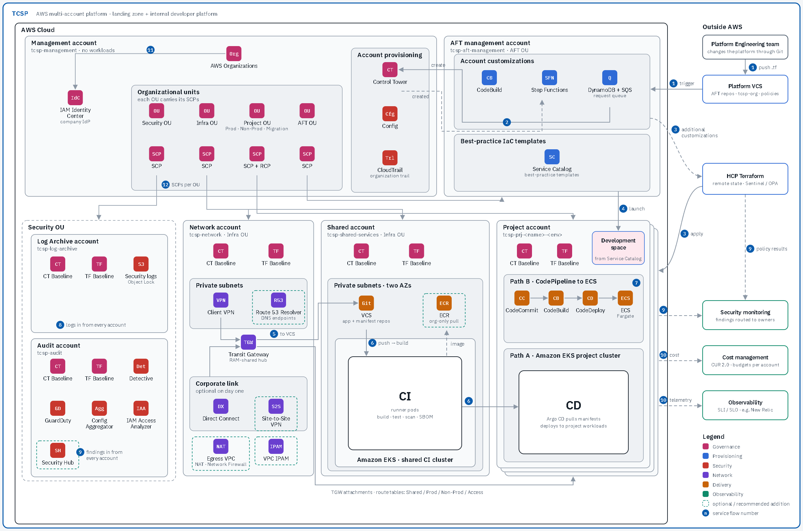
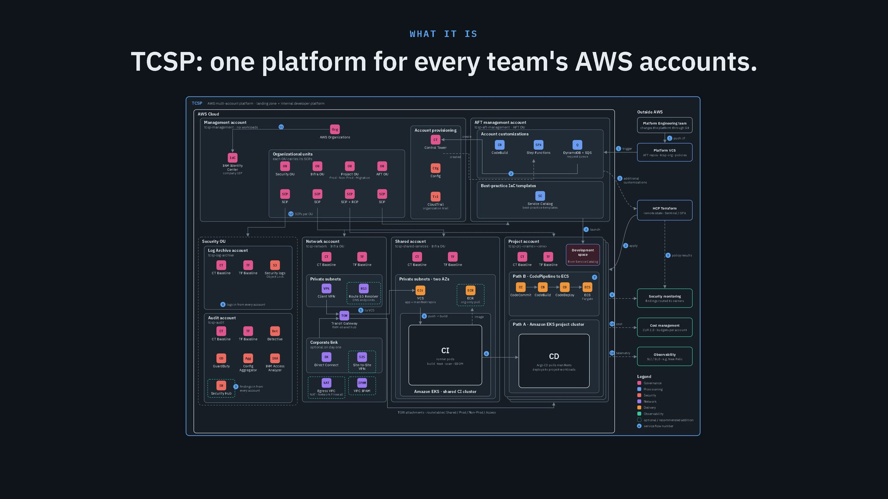

# TCSP

<!-- TODO: confirm what TCSP stands for -->

**An AWS multi-account platform: a landing zone and an internal developer platform that give every project a governed account from a Git request, with guardrails instead of gates and with security and observability built in from day one.**



**Interactive architecture:** [`site/index.html`](site/index.html). Play any of the 12 service flows step by step, take the guided tour, filter by layer, or click a service for its detail. Deep links work, for example `site/index.html#flow-2` (account vending) or `site/index.html#c-tgw` (Transit Gateway).

To open it locally, clone the repository and open the file in a browser. No build step or server is needed:

```bash
git clone <this-repo-url> && cd tcsp-platform
start site/index.html        # Windows
open site/index.html         # macOS
xdg-open site/index.html     # Linux
```

A dark version of the diagram is in [`assets/architecture-dark.png`](assets/architecture-dark.png).

## Why TCSP

- **Weeks of tickets before the first line of code.** Getting an account, a network, access and a security sign-off takes a chain of separate approvals.
- **Every team does security differently.** Logging, encryption, detection and access are set up by hand, with uneven results and no central evidence for audits.
- **Network and CI sprawl.** Each team builds its own VPC edge, runners and registries, and nobody sees the whole picture.
- **Platform teams become bottlenecks.** When every change needs a central approval, the central team turns into a queue.

## What it gives teams

All figures are design targets, not measured results.

- **Fast, governed accounts.** Target: a baselined account in under one business day from an approved request, created by automation with no console clicks.
- **Guardrails, not gates.** Admin rights inside your own account. Organization policies set hard limits outside it, so changes do not wait for approval.
- **Security and observability from day one.** Central logs, organization-wide detection, telemetry and a budget are wired into every account at creation.
- **Golden paths to production.** A Development space, shared CI on EKS with CD in your own cluster (Path A), or CodePipeline to ECS (Path B). Target: first production-style deploy on the same day the account is ready.

## How it works in 60 seconds

**Account vending (flows 1 to 3)**

1. A team asks for an account in ITSM; the request becomes a short Terraform file in `aft-account-request`.
2. Review and merge are the approval. The merge triggers the AFT pipeline.
3. AFT queues the request and asks Control Tower to create the account in its target OU, where the CT Baseline is applied.
4. AFT applies the TF Baseline, then HCP Terraform applies the account's customization set after a policy check: VPC from IPAM, Transit Gateway attachment, observability and budget.
5. The team signs in through IAM Identity Center as ProjectAdmin. Logs, findings and telemetry are already flowing.

**Delivery (flow 6, Path A)**

1. An engineer connects through Client VPN and pushes code to the shared VCS.
2. Shared CI on EKS builds the image, runs tests, scans source and image, and creates an SBOM.
3. The image goes to ECR, readable only inside the organization.
4. CI updates the image tag in the manifest repository. It never holds credentials for the project account.
5. Argo CD in the project's own EKS cluster pulls the change and deploys it.

Teams that do not want Kubernetes use Path B (flow 7): CodeCommit, CodeBuild, CodeDeploy and ECS, all inside their own account.

## Architecture at a glance

| Account | OU | Purpose |
| --- | --- | --- |
| `tcsp-management` | Root | Owns the organization, OUs, SCPs, Control Tower, IAM Identity Center and billing. No workloads. |
| `tcsp-aft-management` | AFT | Account factory: turns a Git request into a governed account; hosts the best-practice template portfolio. |
| `tcsp-log-archive` | Security | Write-once storage for every account's logs (CloudTrail, Config, VPC Flow Logs). |
| `tcsp-audit` | Security | Delegated admin for GuardDuty, Detective, Config, IAM Access Analyzer and Security Hub. |
| `tcsp-network` | Infra | Transit Gateway, Client VPN, corporate link, central egress, IPAM and DNS. |
| `tcsp-shared-services` | Infra | Shared VCS, shared CI on EKS, ECR. |
| `tcsp-prj-<name>-<env>` (many) | Project / Prod, Non-Prod, Migration | One account per project and environment, with admin rights for the team. |

## Explainer video

[](video/tcsp-explainer.mp4)

A short, calm walkthrough of why the platform is needed and what it does: [`video/tcsp-explainer.mp4`](video/tcsp-explainer.mp4).

## Documentation map

| Document | What it covers |
| --- | --- |
| [docs/00-overview.md](docs/00-overview.md) | The master overview: problems, ideas, how the parts fit, a day in the life, trade-offs |
| [docs/01-guardrails.md](docs/01-guardrails.md) | The five guardrail layers and the SCP starter set |
| [docs/02-service-flows.md](docs/02-service-flows.md) | The 12 service flows, hop by hop |
| [docs/03-build-plan.md](docs/03-build-plan.md) | Build phases 0 to 6, each with an exit gate |
| [docs/04-migration.md](docs/04-migration.md) | Bringing existing OUs and production accounts onto TCSP |
| [docs/05-decisions-and-risks.md](docs/05-decisions-and-risks.md) | Open decisions, risks and mitigations |
| [docs/glossary.md](docs/glossary.md) | Terms used across the docs |
| [docs/components/](docs/components/README.md) | One page per component, grouped by layer |
| [site/index.html](site/index.html) | The interactive architecture |

## Status

**Design and reference architecture.** This repository contains the design, documentation and interactive architecture. It does not contain deployable Terraform yet.

Open decisions (detail in [docs/05-decisions-and-risks.md](docs/05-decisions-and-risks.md)):

- [ ] Home and DR Region
- [ ] Company IdP for IAM Identity Center
- [ ] VCS product for the platform and the Shared account
- [ ] HCP Terraform or open-source Terraform for AFT
- [ ] Observability vendor
- [ ] CI and CD tools for Path A
- [ ] Direct Connect on day one or later
- [ ] Log retention periods and the shared-cost split

## License

All rights reserved. See [LICENSE](LICENSE).
