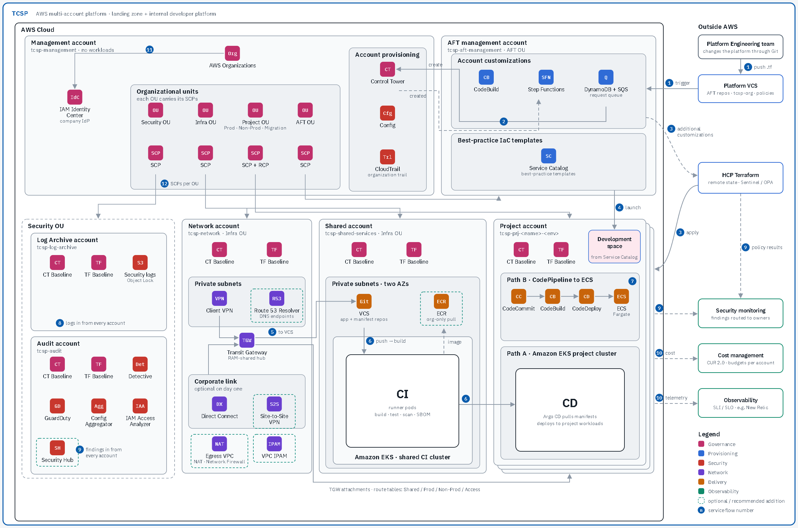

# TCSP overview

A ten-minute read for engineers and managers. It explains what TCSP is, which problems it removes, how the parts fit together, and where to read more.

## 1. What TCSP is

TCSP is an AWS multi-account platform: a landing zone and an internal developer platform in one design. Every project gets its own AWS account, created from a request in Git and already governed, logged, monitored and connected. Project teams get admin rights inside their account, while a small set of organization-wide guardrails keeps every account inside safe limits.

## 2. The problems it fixes

- **Account setup takes weeks or months.** A new project waits on a chain of tickets and approvals for an account, a network, access and security sign-off before anyone writes code.
- **Every team does security differently.** Logging, encryption, detection and access are configured by hand, per team, with uneven results.
- **Network and CI sprawl.** Each team builds its own VPC edge, peering, NAT, runners and registries. Nobody has the full picture, and the same work is done many times.
- **No central evidence for audits.** Logs and findings live in each team's account, if they exist at all, and can be changed by the people being audited.
- **Platform teams become approval bottlenecks.** When every change needs a central team to click or approve, the central team turns into a queue and everyone waits.

## 3. How it fixes them

TCSP rests on four ideas.

1. **An account per project.** An AWS account is the strongest isolation boundary AWS offers. Each project and environment gets its own account, so a mistake or breach stays inside it and cost lands per account without tagging work.
2. **Guardrails, not gates.** Teams get admin rights inside their own account. Organization policies (SCPs, RCPs and declarative policies) set hard limits outside it: approved Regions only, logging and detection cannot be switched off, no network bypass, no public data. Nobody needs to approve each change, because the dangerous ones are impossible.
3. **Everything as code, through Git.** Accounts, baselines, network, policies and templates are Terraform in Git. A merged request is the approval, history is the audit trail, and a revert is the rollback.
4. **Security and observability wired in at account birth.** Every account is born with two baselines, central logging, organization-wide detection, observability integration and a budget. Nothing depends on a team remembering to set it up.

## 4. How the parts fit together

Open the [interactive version](../site/index.html) to play each flow step by step, filter by layer, or click any service for its detail.

**Top row: the control plane.**

- The **management account** owns AWS Organizations, the OU tree, the organization policies, Control Tower, IAM Identity Center and billing. It runs no workloads.
- The **AFT management account** runs Account Factory for Terraform: a pipeline that turns a merged Git request into a governed account, and a Service Catalog portfolio of approved templates.

**Bottom row: the accounts that control plane creates.**

- The **Security OU** holds the **Log Archive account** (write-once storage for every account's logs) and the **Audit account** (delegated administrator for GuardDuty, Detective, Config, IAM Access Analyzer and Security Hub).
- The **Infra OU** holds the **Network account** (Transit Gateway, Client VPN, corporate link, central egress, IPAM, DNS) and the **Shared account** (shared VCS, shared CI on EKS, ECR).
- The **Project OU**, split into Prod, Non-Prod and a temporary Migration OU, holds one **project account** per project and environment. Each one has a Development space and one of two delivery paths: CD on its own EKS cluster (Path A) or CodePipeline to ECS (Path B).

**Right side: outside AWS.** The Platform Engineering team and the platform VCS, HCP Terraform with its policy checks, and the security monitoring, cost management and observability platforms.

**The 12 flows connect them** ([full detail](02-service-flows.md)):

| # | Flow | What it connects |
| --- | --- | --- |
| 1 | Platform change | Platform Engineering team → platform VCS → AFT |
| 2 | Account vending | AFT → Control Tower → new account in its OU, both baselines |
| 3 | Additional customizations | AFT → HCP Terraform policy check → VPC, TGW attachment, hooks |
| 4 | Template deploy | Service Catalog → Development space |
| 5 | Engineer access | Client VPN → Transit Gateway → shared VCS and private resources |
| 6 | Container delivery (Path A) | VCS → shared CI on EKS → ECR → CD on project EKS |
| 7 | AWS-native delivery (Path B) | CodeCommit → CodeBuild → CodeDeploy → ECS |
| 8 | Logging | Every account → Log Archive |
| 9 | Security findings | Every account → Audit → security monitoring → owning team |
| 10 | Telemetry and cost | Every account → observability and cost management |
| 11 | Sign-in | Company IdP → IAM Identity Center → role in the account |
| 12 | Guardrail check | Every API call → IAM → SCPs and RCPs on the OU path |

Flows 1 to 4 build accounts, 5 to 7 ship software, 8 to 10 watch it, and 11 and 12 control who can do what.

## 5. A day in the life

A team needs a new service, "orders", and starts on a Monday morning.

1. **Request.** The team fills in one ITSM form: project name, environment, owner, cost centre, delivery path. One form replaces the separate requests for account, network, access and monitoring.
2. **Request as code (flow 1).** An ITSM automation, or the Platform Engineering team, opens a merge request in `aft-account-request` with a short Terraform file for `tcsp-prj-orders-dev`. A reviewer merges it.
3. **Account vending (flow 2).** AFT queues the request, Control Tower creates the account in Project / Non-Prod and applies the CT Baseline, and AFT applies the TF Baseline. Logging (flow 8), detection (flow 9) and telemetry and cost (flow 10) are active from this moment.
4. **Customizations (flow 3).** HCP Terraform applies the `project-standard` set after its policy check: a VPC from IPAM attached to the Transit Gateway, the observability integration and a budget.
5. **Sign-in (flow 11).** The team's IdP group is assigned ProjectAdmin and ProjectDeveloper. Engineers sign in through IAM Identity Center; nobody receives a password or access key.
6. **First experiments (flow 4).** The team launches the Development space from Service Catalog and starts trying things.
7. **First deploy (flows 5 and 6).** Engineers connect through Client VPN, push to their repository in the shared VCS, and the shared CI builds, tests, scans and pushes the image. Argo CD in the project's EKS cluster pulls the change and deploys it.
8. **Production.** The team requests `tcsp-prj-orders-prod` the same way. It lands in Project / Prod with stricter guardrails, and the same pipeline promotes the same image.

Design target: the whole path, from approved request to first deploy, inside one to two business days, with the account itself ready within hours.

Throughout, the guardrail check (flow 12) runs on every API call. If the team tries something the platform forbids, such as creating an Internet Gateway, the call is denied and recorded, and nothing else needs to be reviewed.

## 6. What it improves

All "with TCSP" values are design targets, to be measured once the platform runs.

| Area | Typical situation without a platform | With TCSP (target) |
| --- | --- | --- |
| Account lead time | Weeks to months of tickets and approvals | A governed, baselined account in under one business day from approved request |
| Security setup effort | Manual checklists per account, repeated by every team | No manual security setup: the baseline is code, applied to every account automatically |
| Consistency | Each account configured differently | Every account starts from the same two baselines; drift is detected centrally |
| Audit evidence | Scattered, changeable logs | Organization-wide trail, Config history and findings in write-once central storage |
| Developer autonomy | Central team approves each change | Admin inside the account, with hard limits enforced by policy instead of approval |
| Onboarding new teams | Each team designs network, CI and monitoring | Golden paths: Development space, Path A or Path B, CI, observability and budgets ready on day one |

## 7. Guardrail model summary

Five layers, each catching a different kind of failure, so a gap in one is covered by the next. Detail and the SCP starter set: [01-guardrails.md](01-guardrails.md).

| Layer | When it acts | Mechanism | Example it catches |
| --- | --- | --- | --- |
| 1. Preventive | Before an API call succeeds | SCPs, RCPs, declarative policies, Control Tower preventive controls | Launching in an unapproved Region; disabling CloudTrail |
| 2. Provision-time baseline | When the account is created | CT Baseline + TF Baseline through AFT | An account born with public S3 allowed or no default encryption |
| 3. Code-time policy | Before Terraform applies | Sentinel or OPA on every plan | A security group open to the internet on SSH |
| 4. Delivery-time | Before a container ships | Source, dependency and image scans, SBOM in shared CI; ECR scanning | A vulnerable base image or a hard-coded secret |
| 5. Detective and runtime | After something is live | GuardDuty, Detective, Config, Access Analyzer, Security Hub; central logs | Crypto-mining, a bucket shared outside the organization, drift |

## 8. Responsibility split

| Area | Platform Engineering team | Security | Project teams |
| --- | --- | --- | --- |
| Organization, OUs, SCPs | Builds and runs | Co-owns policy content | Requests exceptions |
| Account factory and baselines | Builds and runs | Reviews baseline content | Uses |
| Network, egress, remote access | Builds and runs | Reviews firewall and access rules | Attaches through templates |
| Shared VCS, CI, ECR | Builds and runs | Sets scanning thresholds | Owns their repositories and pipelines |
| Logging and detection | Operates the plumbing | Owns Log Archive, Audit, triage | Fixes findings in their accounts |
| Observability and cost | Platform dashboards, templates | | Their own dashboards, alerts and budgets |
| Application security | | Guidance and review | Owns authorization, data handling, secrets, incident response for their app |
| Workloads | | | Builds, runs and is on call for them |

The Platform Engineering team works through Git, not tickets. Its job is to make the right way the easy way, not to approve each change.

## 9. Trade-offs

| Trade-off | Why it matters | Mitigation |
| --- | --- | --- |
| Blast radius of shared parts | AFT, the Transit Gateway and shared CI serve every project; an outage stops many teams at once | Two AZs everywhere, on-call ownership, staged rollouts, canary accounts, plan-only runs |
| SCP friction | A policy that is too broad blocks real work and recreates the bottleneck | Policy tests in CI, a time-limited exception process, the Migration OU, a quarterly review |
| Network complexity | Hub-and-spoke routing, central egress and DNS need real network skills | Small number of route tables, reachability tests in the pipeline, documented patterns |
| SaaS cost | HCP Terraform, observability ingest and shared CI grow with adoption | Charge back per project, ingest limits, retention per environment, open-source options where cost matters more |
| Account count | Hundreds of accounts need naming, ownership and cleanup | Owner and cost-centre tags required at request time, a Suspended OU for closing accounts |

## 10. Where to go next

- [01-guardrails.md](01-guardrails.md): the five guardrail layers and the SCP starter set
- [02-service-flows.md](02-service-flows.md): the 12 flows, hop by hop
- [03-build-plan.md](03-build-plan.md): phases 0 to 6, each with an exit gate
- [04-migration.md](04-migration.md): bringing existing OUs and production accounts onto TCSP
- [05-decisions-and-risks.md](05-decisions-and-risks.md): open decisions, risks and mitigations
- [glossary.md](glossary.md): terms used across the docs
- [components/README.md](components/README.md): one page per component, grouped by layer
- [Interactive architecture](../site/index.html): play the flows, filter layers, click any service
